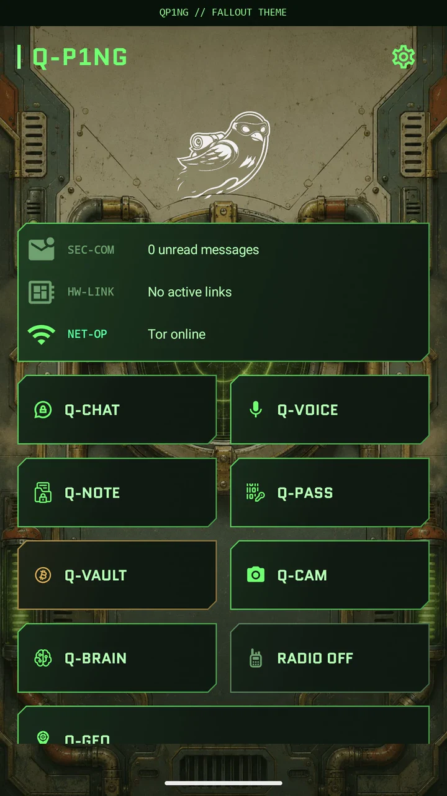
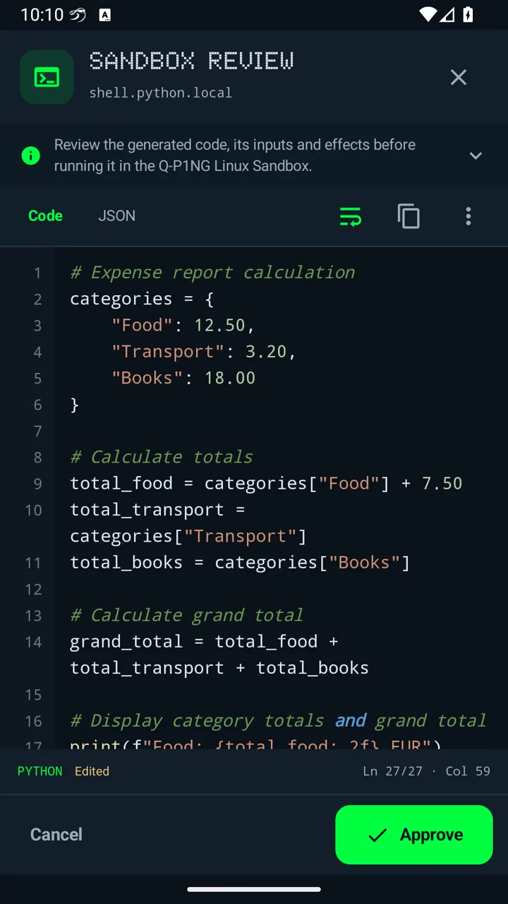
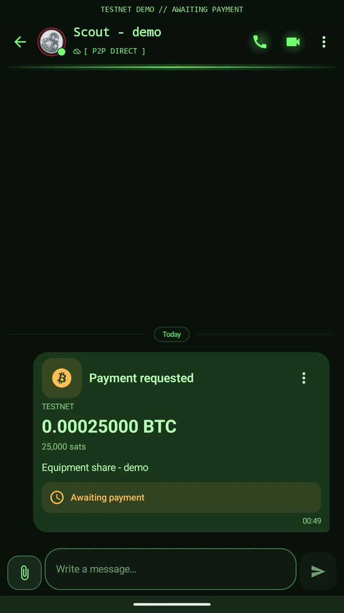

<p align="center">
  
</p>

<h1 align="center">Q-P1NG</h1>

<p align="center">
  <b>Private chats. Offline links. Local AI with Pro.</b><br>
  <i>ghost signals for a nomadic network. Here. Then gone.</i>
</p>

<p align="center">
  <a href="https://www.qp1ng.com/#security">See the app</a> ·
  <a href="https://www.qp1ng.com/pro/#download">Downloads</a> ·
  <a href="https://www.qp1ng.com/pro/">Get Pro · €9.99 once</a> ·
  <a href="https://www.qp1ng.com/privacy.html">Privacy</a> ·
  <a href="SECURITY.md">Security</a> ·
  <a href="#support-development">Support development</a>
</p>

<p align="center">
  
  
  
  
</p>

---

Q-P1NG combines encrypted messaging, built-in Tor and nearby offline communication on Android. No account or phone
number. Pro adds local AI, offline maps, radio, a Bitcoin wallet and an Alpine Linux workspace.

**Core is free. Pro is €9.99 once on the website: a lifetime personal licence, updates included, no subscription.**

**Release status:** the first Core and Pro APKs are being prepared. Check the [download page](https://www.qp1ng.com/pro/#download)
for availability. Google Play is also in preparation; the Pro licence checkout is already available.

## Why choose Q-P1NG?

- **Keep your number to yourself.** Create an identity on your phone. Exchange contact cards offline by animated QR,
  acoustic signals, NFC or nearby Wi-Fi/Bluetooth discovery. Tor runs inside the app, with no separate Orbot setup.
- **Keep talking without internet.** Use Bluetooth mesh or local Wi-Fi for nearby communication. Pro adds radio
  routes when you have the required hardware.
- **Choose what stays.** Ghost sessions keep their message database in RAM. Calculator covers, decoy and duress PINs
  give you separate controls for access and emergencies.
- **Bring your tools with you.** Pro puts AI, maps, voice tools and automations on the phone, for work in the field
  as well as everyday tasks.

Built for journalists, activists, researchers, radio operators and anyone who wants private conversations without
handing over a phone number.

## Core or Pro?

| What you get | Core · Free | Pro · €9.99 once¹ |
|---|:---:|:---:|
| Encrypted chat, voice notes, files, voice and video calls | ✓ | ✓ |
| Built-in Tor, Bluetooth mesh and local Wi-Fi communication | ✓ | ✓ |
| Ghost sessions, decoy and duress controls, panic wipe | ✓ | ✓ |
| Encrypted passwords and notes, secure keyboard and accessibility themes | ✓ | ✓ |
| Q-Feed, Q-Cast listening and Secure Live with face blur | ✓ | ✓ |
| Local AI, image generation, dictation and voice tools | — | ✓ |
| Offline map packs, radio and counter-surveillance tools | — | ✓ |
| Bitcoin vault, Q-Torrent, automations and Q-Cast broadcasting | — | ✓ |
| Every theme, font and background | — | ✓ |
| Alpine Linux sandbox | — | Website edition |

¹ Website licence. Google Play Pro will be a separate paid app. Play builds exclude the Linux sandbox and self-updates.

## What Pro adds

| Put it to work | Tools in Pro |
|---|---|
| **Use AI away from the cloud** | Q-Brain chat and vision, Q-Dream images, Whisper dictation, reading voices and call voice effects. Download models first; performance depends on your phone and model. Online AI is optional and uses your own provider key. |
| **Prepare for a blackout** | Download Q-GEO map packs before losing connectivity. Add LoRa, SDR and GhostWave radio tools for routes and signals beyond the mobile network. Radio features need the appropriate hardware. |
| **Build your own workflow** | Q-Scenarios and ActionForge automate tasks on the phone. The website edition adds an Alpine Linux sandbox for scripts and tools. |
| **Request Bitcoin in chat** | Create an amount and memo, share a payment request with a contact and review it in the conversation. The self-custody vault keeps your keys on the phone. |
| **Share and broadcast** | Q-Torrent shares large files between contacts. Q-Cast broadcasting turns your phone into your own audio station. Listening stays free. |
| **Inspect and personalise** | Q-SWEEP offers counter-surveillance and tracker checks. Theme Lab unlocks every theme, font, background and custom colours. |

**One purchase, every Pro feature for your edition.** The website key is checked offline and covers the devices under
your control. Keep it for your next phone. Buying Pro also supports independent development.

[**Get Pro · €9.99 lifetime**](https://www.qp1ng.com/pro/#buy) ·
[Compare features](https://www.qp1ng.com/pro/#features) ·
[14-day refund policy](https://www.qp1ng.com/refund.html)

## See it in action

Click a preview to watch the walkthrough on the website.

| Inside Q-P1NG | Create a tool · Pro | Request BTC · Pro |
|:---:|:---:|:---:|
| <a href="https://www.qp1ng.com/#security"></a> | <a href="https://www.qp1ng.com/#qbrain-demo"></a> | <a href="https://www.qp1ng.com/#btc-chat-demo"></a> |
| Tor, Ghost, animated QR and local links | Generate, review and run a tool | Amount, memo and request details |

Recorded Android demos with sample data and shortened waits. Each walkthrough explains its recording setup; the BTC
demo uses Testnet and an offline contact, with no payment made.

## Get started

1. **Check the [downloads](https://www.qp1ng.com/pro/#download).** Choose Core for free messaging, or the website Pro
   build for the advanced tools. Android 8.0 or later, on a 64-bit ARM phone (`arm64-v8a`).
2. **Add someone you trust.** Create your local identity, exchange contact cards by QR and choose Tor or a nearby
   offline connection.
3. **Activate Pro when you need it.** Buy a [website licence](https://www.qp1ng.com/pro/#buy), then open a Pro feature
   or Info → Activate Pro and paste the key. Bitcoin payment is available; cards are coming soon.

Website releases will be listed with their SHA-256. The app checks an update's signature, size, hash and signing
certificate before installation. Google Play editions will update through Google Play.

## Security in plain terms

- **Identity and storage.** Keys are generated on the phone, with private identity keys in the Android Keystore.
  Local databases use SQLCipher; encrypted backups use Argon2id and AES-256-GCM.
- **Messages.** Each message uses a fresh AES-256-GCM key sealed to the recipient's RSA-2048 key, is signed by the
  sender and padded to a fixed size.
- **Delivery.** Online contacts connect over Tor onion services. For offline delivery, sealed envelopes can wait on
  Nostr relays reached through Tor. Relays cannot read their contents; our relay deletes envelopes after seven days.
- **Calls.** Voice, video and Secure Live travel between phones, directly or over Tor through the called contact's
  phone. The DTLS 1.3 handshake offers hybrid post-quantum key exchange, X25519MLKEM768.
- **No advertising or tracking SDKs.** No analytics or crash-reporting SDKs. Diagnostics can create private reports
  on the device.
- **Emergency controls.** Panic and duress controls can destroy encryption keys and clear app data. Flash storage
  cannot guarantee physical erasure, and a wipe cannot recall copies already sent.

Relays can see envelope public keys, times and sizes. Direct connections expose your IP to the service or peer;
public feed posts and Bitcoin blockchain activity are public. No app can protect a phone already controlled by
spyware. Read the [privacy policy](https://www.qp1ng.com/privacy.html) for the services and routes involved.

## What's in this repository

The app's source code is not public. This repository holds what the website and the app publish:

| Path | Content |
|---|---|
| `docs/` | The website [www.qp1ng.com](https://www.qp1ng.com), also mirrored on IPFS (`ipns://qp1ng.com`) |
| `docs/pro/` | The Pro checkout page |
| `docs/manifest.json`, `docs/categories/` | The catalog of on-device AI models |
| `docs/maps/` | Q-GEO sample maps and the signed map catalog |
| `docs/firmware/` | LoRa firmware for the LilyGO T-Deck, with a browser installer |
| `docs/updates/` | The website edition's signed update manifest, from the first app release |
| Releases | Runtime assets and corresponding third-party sources; website APKs will be added when released |

## Security

Please report vulnerabilities privately, not in a public issue: see [SECURITY.md](SECURITY.md).

## Support development

Q-P1NG is built by a small independent team. If you want to support its development, you can send bitcoin to this
address:

<p align="center">
  
</p>

```
374KXiCjuvSr5aWXf1tzCB8fUzXhHanngi
```

A contribution is voluntary: it does not buy a licence or unlock Pro.

## Legal

Q-P1NG is commercial software, © 2026 ZonkeyNet, distributed under the [EULA](LICENSE). Q-P1NG and Quantum P1NG are
trademarks of ZonkeyNet.

[Terms](https://www.qp1ng.com/terms.html) · [Privacy](https://www.qp1ng.com/privacy.html) ·
[Refunds](https://www.qp1ng.com/refund.html) · [Licence](https://www.qp1ng.com/license.html)

Contact: support@qp1ng.com · legal@qp1ng.com

<p align="center">
  <i>Your identity. Your routes. Your phone.</i>
</p>
